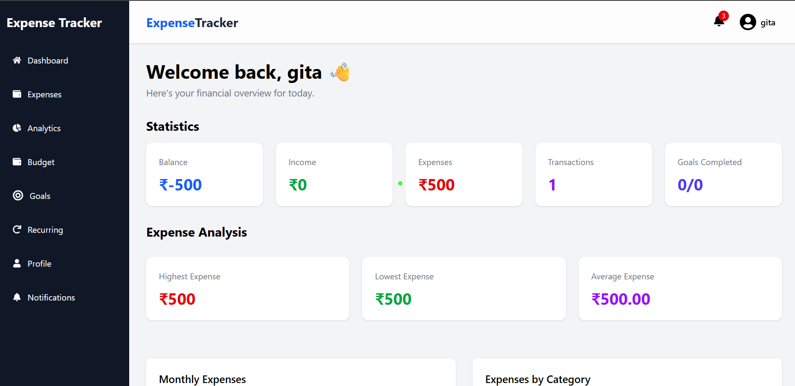

# 💰 Expense Tracker

A full-stack personal finance management application designed to help users **track income and expenses, manage budgets, monitor financial goals, and handle recurring transactions** from a single dashboard.

🔗 **Live Demo:** [Expense Tracker](https://expense-tracker-five-silk-48.vercel.app?utm_source=chatgpt.com)

---

## ✨ Features

* 🔐 **Authentication** — Secure user registration and login using JWT
* 💸 **Expense Management** — Add, edit, delete, and manage expenses
* 💰 **Income Tracking** — Keep track of income and financial activity
* 📊 **Dashboard Analytics** — Visualize spending and financial insights
* 🏷️ **Categories** — Organize transactions by category
* 🔎 **Search & Filtering** — Quickly find specific transactions
* 🎯 **Financial Goals** — Set and track personal financial goals
* 💳 **Budget Management** — Create and monitor spending budgets
* 🔄 **Recurring Transactions** — Manage recurring income and expenses
* 🔔 **Notifications** — Stay updated with important financial activity
* 👤 **Profile Management** — Manage personal account information
* 🖼️ **Profile Image Upload** — Upload and manage profile pictures
* 📱 **Responsive Design** — Optimized for desktop and mobile devices

---

## 🖥️ Screenshots

> Add screenshots of your dashboard, transactions, budgets, goals, and profile pages here.

```text
📸 Dashboard
📸 Expense Management
📸 Budget Management
📸 Financial Goals
```

For example:

```markdown

```

---

## 🛠️ Tech Stack

### Frontend

* React.js
* Vite
* Tailwind CSS
* React Router
* Axios
* React Hook Form

### Backend

* Node.js
* Express.js
* MongoDB
* Mongoose
* JWT
* Bcrypt
* Multer

### Deployment

* Vercel — Frontend
* Render — Backend
* MongoDB Atlas — Database

---

## 🏗️ Architecture

```text
┌─────────────────────┐
│      React + Vite   │
│      Frontend       │
└──────────┬──────────┘
           │
           │ REST API
           ▼
┌─────────────────────┐
│   Node.js + Express │
│      Backend        │
└──────────┬──────────┘
           │
           ▼
┌─────────────────────┐
│       MongoDB       │
│      Database       │
└─────────────────────┘
```

---

## 🔐 Authentication

The application uses **JWT-based authentication** to protect user-specific resources.

### Authentication Flow

```text
User
  ↓
Register / Login
  ↓
Backend validates credentials
  ↓
JWT Token generated
  ↓
Token stored on client
  ↓
Token attached to protected API requests
  ↓
Authenticated response
```

Protected requests use:

```http
Authorization: Bearer <JWT_TOKEN>
```

---

## 🌐 Deployment

### Frontend

[Live Frontend — Vercel](https://expense-tracker-five-silk-48.vercel.app?utm_source=chatgpt.com)

### Backend API

[Backend API — Render](https://expense-tracker-8pzc.onrender.com?utm_source=chatgpt.com)

### API Base URL

**Local**

```text
http://localhost:5000/api
```

**Production**

```text
https://expense-tracker-8pzc.onrender.com/api
```

---

# 🚀 Getting Started

Follow these steps to run the project locally.

## Prerequisites

Make sure you have installed:

* Node.js
* npm
* MongoDB / MongoDB Atlas
* Git

---

## 1. Clone the Repository

```bash
git clone <repository-url>
cd Expense-Tracker
```

---

## 2. Backend Setup

```bash
cd expense-tracker-backend
npm install
```

Create a `.env` file:

```env
PORT=5000
MONGO_URI=your_mongodb_connection_string
JWT_SECRET=your_jwt_secret
```

Start the backend:

```bash
npm start
```

The backend will run at:

```text
http://localhost:5000
```

---

## 3. Frontend Setup

Open a new terminal:

```bash
cd expense-tracker-frontend
npm install
```

Create a `.env` file:

```env
VITE_API_URL=http://localhost:5000/api
```

Start the development server:

```bash
npm run dev
```

The frontend will be available at:

```text
http://localhost:5173
```

---

## 📁 Project Structure

```text
Expense-Tracker/
│
├── expense-tracker-frontend/
│   ├── src/
│   │   ├── components/
│   │   ├── pages/
│   │   ├── services/
│   │   ├── hooks/
│   │   └── ...
│   ├── public/
│   └── package.json
│
├── expense-tracker-backend/
│   ├── controllers/
│   ├── routes/
│   ├── models/
│   ├── middleware/
│   ├── config/
│   ├── uploads/
│   └── package.json
│
└── README.md
```

---

## ⚙️ Environment Variables

### Frontend

```env
VITE_API_URL=http://localhost:5000/api
```

### Backend

```env
PORT=5000
MONGO_URI=your_database_url
JWT_SECRET=your_secret_key
```

> Never commit your `.env` file or expose secret keys in the repository.

---

## 🧪 Testing Checklist

Before deployment, verify the following:

* [ ] User registration
* [ ] User login
* [ ] JWT authentication
* [ ] Dashboard loading
* [ ] Add expense
* [ ] Edit expense
* [ ] Delete expense
* [ ] Income tracking
* [ ] Budget creation
* [ ] Financial goals
* [ ] Recurring transactions
* [ ] Notifications
* [ ] Profile management
* [ ] Profile image upload
* [ ] Logout
* [ ] Responsive UI

---

## 🚧 Future Improvements

* 📈 Advanced financial analytics
* 📊 Monthly and yearly reports
* 📄 Export transactions to CSV/PDF
* 💱 Multi-currency support
* 🔔 Smart spending alerts
* 🤖 AI-powered spending insights
* 📅 Calendar-based transaction tracking
* 🌙 Dark mode
* 📱 Progressive Web App support

---

## 🎯 Project Goal

The goal of Expense Tracker is to provide users with a **simple, centralized, and intuitive way to manage their personal finances** while providing useful insights into their spending habits.

---

## 👩‍💻 Author

**Pikanshi Mehta**

Computer Science Engineering
NIT Hamirpur

---

⭐ If you found this project useful, consider giving it a **star**!
