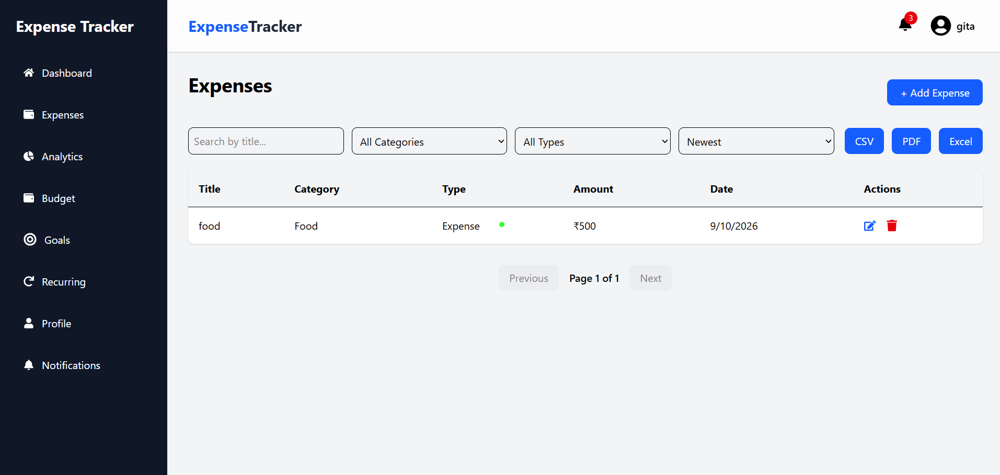
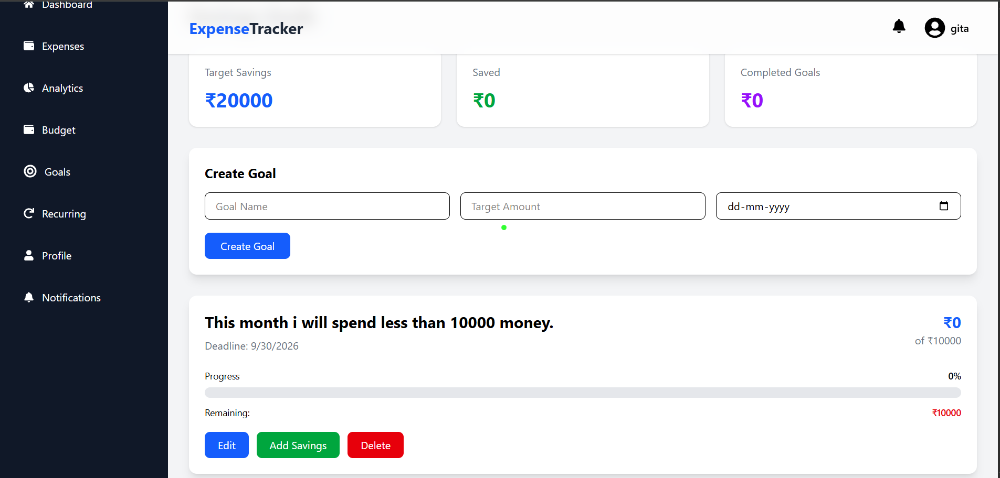

# 💰 Expense Tracker

> A full-stack personal finance management application for tracking **income, expenses, budgets, recurring transactions, and financial goals** through a centralized and intuitive dashboard.

<p align="center">
  <a href="https://expense-tracker-five-silk-48.vercel.app">
    
  </a>
</p>

<p align="center">
  
  
  
  
  
  
</p>

---

## 📌 Overview

**Expense Tracker** is a full-stack web application designed to make personal finance management simple and organized.

Users can manage their financial activity from a single dashboard, including expenses, income, budgets, financial goals, and recurring transactions.

The application combines a responsive frontend with a RESTful backend and MongoDB database to provide a complete end-to-end financial management experience.

---

## ✨ Features

### 🔐 Authentication & User Management

- User registration and login
- JWT-based authentication
- Protected API routes
- Secure password hashing with Bcrypt
- Profile management
- Profile image upload

### 💸 Expense & Income Management

- Add, edit, and delete expenses
- Track income and expenses
- Categorize transactions
- Search and filter transactions
- Track transaction history

### 💳 Budget Management

- Create and manage budgets
- Monitor spending against budgets
- Track budget-related activity

### 🎯 Financial Goals

- Create financial goals
- Monitor goal progress
- Manage multiple financial objectives

### 🔄 Recurring Transactions

- Manage recurring income
- Manage recurring expenses
- Organize regular financial activity

### 📊 Dashboard & Analytics

- Centralized financial dashboard
- Spending insights
- Category-based financial information
- Financial activity overview

### 🔔 Notifications

- Financial activity notifications
- Important account updates

### 📱 Responsive Design

- Responsive user interface
- Desktop and mobile friendly
- Clean and intuitive navigation

---

## 🖥️ Screenshots

### 📊 Dashboard


### 💸 Expense Management



### 💰 Budget Management


### 🎯 Financial Goals



---

## 🛠️ Tech Stack

### Frontend

| Technology      | Purpose                       |
| --------------- | ----------------------------- |
| React.js        | UI development                |
| Vite            | Frontend build tool           |
| Tailwind CSS    | Styling and responsive design |
| React Router    | Client-side routing           |
| Axios           | API communication             |
| React Hook Form | Form management               |

### Backend

| Technology | Purpose                 |
| ---------- | ----------------------- |
| Node.js    | Runtime environment     |
| Express.js | REST API framework      |
| MongoDB    | Database                |
| Mongoose   | MongoDB object modeling |
| JWT        | Authentication          |
| Bcrypt     | Password hashing        |
| Multer     | File/image uploads      |

### Deployment

| Service       | Usage               |
| ------------- | ------------------- |
| Vercel        | Frontend deployment |
| Render        | Backend deployment  |
| MongoDB Atlas | Cloud database      |

---

## 🏗️ Architecture

```text
                         ┌─────────────────────┐
                         │        User         │
                         └──────────┬──────────┘
                                    │
                                    ▼
                         ┌─────────────────────┐
                         │    React + Vite     │
                         │      Frontend       │
                         └──────────┬──────────┘
                                    │
                              REST API
                                    │
                                    ▼
                         ┌─────────────────────┐
                         │  Node.js + Express  │
                         │       Backend       │
                         └──────────┬──────────┘
                                    │
                                    ▼
                         ┌─────────────────────┐
                         │       MongoDB       │
                         │      Database       │
                         └─────────────────────┘
```

---

## 🔐 Authentication Flow

The application uses **JWT-based authentication** to secure user accounts and protected resources.

```text
User
  │
  ▼
Register / Login
  │
  ▼
Backend validates credentials
  │
  ▼
JWT Token Generated
  │
  ▼
Token stored on client
  │
  ▼
Token attached to protected API requests
  │
  ▼
Backend verifies token
  │
  ▼
Authenticated Response
```

Protected requests use:

```http
Authorization: Bearer <JWT_TOKEN>
```

---

## 🌐 Live Deployment

### Frontend

**Live Application:**
https://expense-tracker-five-silk-48.vercel.app

### Backend

**Backend API:**
https://expense-tracker-8pzc.onrender.com

### API Base URL

**Development**

```text
http://localhost:5000/api
```

**Production**

```text
https://expense-tracker-8pzc.onrender.com/api
```

---

# 🚀 Getting Started

Follow the steps below to run the project locally.

## Prerequisites

Make sure you have the following installed:

- Node.js
- npm
- Git
- MongoDB or MongoDB Atlas account

---

## 📥 Clone the Repository

```bash
git clone <repository-url>
cd Expense-Tracker
```

---

## ⚙️ Backend Setup

Navigate to the backend directory:

```bash
cd expense-tracker-backend
```

Install dependencies:

```bash
npm install
```

Create a `.env` file:

```env
PORT=5000
MONGO_URI=your_mongodb_connection_string
JWT_SECRET=your_jwt_secret
```

Start the backend:

```bash
npm start
```

The backend will run at:

```text
http://localhost:5000
```

---

## 🎨 Frontend Setup

Open a new terminal and navigate to the frontend:

```bash
cd expense-tracker-frontend
```

Install dependencies:

```bash
npm install
```

Create a `.env` file:

```env
VITE_API_URL=http://localhost:5000/api
```

Start the development server:

```bash
npm run dev
```

The frontend will be available at:

```text
http://localhost:5173
```

---

## 📁 Project Structure

```text
Expense-Tracker/
│
├── expense-tracker-frontend/
│   ├── src/
│   │   ├── components/
│   │   ├── pages/
│   │   ├── services/
│   │   ├── hooks/
│   │   └── ...
│   ├── public/
│   └── package.json
│
├── expense-tracker-backend/
│   ├── controllers/
│   ├── routes/
│   ├── models/
│   ├── middleware/
│   ├── config/
│   ├── uploads/
│   └── package.json
│
├── screenshots/
│   ├── dashboard.png
│   ├── expenses.png
│   ├── budgets.png
│   └── goals.png
│
└── README.md
```

---

## 🔑 Environment Variables

### Frontend

```env
VITE_API_URL=http://localhost:5000/api
```

### Backend

```env
PORT=5000
MONGO_URI=your_mongodb_connection_string
JWT_SECRET=your_secret_key
```

> ⚠️ Never commit `.env` files or expose API keys, database credentials, or JWT secrets in your repository.

---

## 🧪 Testing Checklist

Before deployment, verify the following:

- [ ] User registration
- [ ] User login
- [ ] JWT authentication
- [ ] Dashboard
- [ ] Add expense
- [ ] Edit expense
- [ ] Delete expense
- [ ] Income tracking
- [ ] Budget management
- [ ] Financial goals
- [ ] Recurring transactions
- [ ] Notifications
- [ ] Profile management
- [ ] Profile image upload
- [ ] Logout
- [ ] Responsive design

---

## 🚧 Future Improvements

- 📈 Advanced financial analytics
- 📊 Monthly and yearly financial reports
- 📄 Export transactions to CSV/PDF
- 💱 Multi-currency support
- 🔔 Smart spending alerts
- 🤖 AI-powered financial insights
- 📅 Calendar-based transaction tracking
- 🌙 Dark mode
- 📱 Progressive Web App support

---

## 🎯 Project Highlights

- Full-stack MERN-style architecture
- RESTful API integration
- JWT-based authentication
- MongoDB database integration
- Responsive UI with Tailwind CSS
- Cloud deployment
- User profile and image management
- Budget and financial goal tracking
- Recurring transaction management

---

## 👩‍💻 Author

### Pikanshi Mehta

**Computer Science Engineering — NIT Hamirpur**

---

<p align="center">
  ⭐ If you found this project useful, consider giving it a star!
</p>
